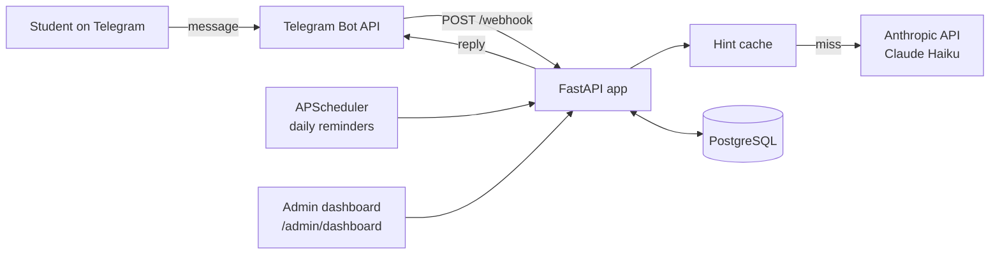

# DARS

DARS is an AI tutoring app for under-served learners in rural South Asia. Students
practise maths daily through a Telegram bot. Hints are Socratic and generated by
Claude, content is bilingual (Bengali and English), and the bot tracks streaks, sends
daily reminders and adapts problem difficulty to each student. The Phase 0 pilot
targets 50 students in Kolkata over 8 weeks. The cost target in
[docs/requirements/REQUIREMENTS.md](docs/requirements/REQUIREMENTS.md) is under
$0.10 per student per month, with an alert if the extrapolated cost exceeds $0.15.

## How it works



- **API:** FastAPI. `POST /webhook` receives Telegram updates (verified with a secret
  token, de-duplicated by `update_id`) and replies through the Bot API using `httpx`.
  REST endpoints cover practice, hints, streaks, student profile and admin stats.
- **Hints:** `src/services/hint_generator.py` resolves a hint in order: in-process
  cache (7-day TTL, keyed by problem, hint number and language), Claude Haiku (3 retries),
  then the pre-written hint from the problem bank. Each student gets at most 10 AI hints
  per day. Token usage is recorded per call for cost tracking. The cache is an
  application-level cache; the code does not use Anthropic's `cache_control` prompt caching.
- **Data:** PostgreSQL through async SQLAlchemy 2 (asyncpg). Alembic migrations use
  psycopg2. Tests run on in-memory SQLite.
- **Scheduling:** APScheduler sends a reminder daily at 18:00 IST (12:30 UTC) and avoids
  repeating recent messages.
- **Learning logic:** problem selection (topic recency, mastery, difficulty mix),
  answer evaluation (numeric tolerance, multiple choice), adaptive difficulty and UTC-based
  streaks with milestones at 7, 14 and 30 days.
- **Deployment:** configured for Railway (`railway.toml`, `Procfile`, `start.sh`).

Bot commands: `/start`, `/practice`, `/hint`, `/streak`, `/grade`, `/language`, `/exit`.

## Content

The problem bank lives in `content/problems/grade_{6,7,8}/*.yaml`: 22 files and
320 problems (grade 6: 77, grade 7: 161, grade 8: 82). Each problem has English and
Bengali question text and a list of hints in both languages.
`scripts/seed_problems.py` loads them into the `problems` table. It is idempotent,
using `(grade, topic, question_en)` as the key, and supports `--dry-run` and `--grade N`.
Without `DATABASE_URL` it falls back to a local SQLite file.

## Getting started

Prerequisites: Python 3.11+, PostgreSQL, and for the full bot a Telegram bot token and
an Anthropic API key. Without an API key the bot serves pre-written hints.

```bash
pip install -e ".[dev]"
cp .env.example .env          # set DATABASE_URL, TELEGRAM_*, ANTHROPIC_API_KEY, ADMIN_TELEGRAM_IDS
alembic upgrade head          # reads DATABASE_URL
python scripts/seed_problems.py
uvicorn src.main:app --reload --port 8000
curl http://localhost:8000/health
```

API docs are served at `http://localhost:8000/docs`. To receive real Telegram messages,
register `https://<your-host>/webhook` with Telegram using the same secret token as
`TELEGRAM_SECRET_TOKEN`.

Tests and checks:

```bash
python -m pytest tests/                  # unit + integration (SQLite, no external services)
bash scripts/validate.sh --skip-slow     # black, ruff, mypy --strict, unit tests, coverage, git status
bash scripts/validate.sh --fix --skip-slow
```

## Project status

Implemented and covered by tests (about 500 tests):

- Telegram webhook with onboarding (grade and language), daily 5-problem practice,
  hints, `/streak`, `/grade`, `/language` and `/exit`.
- Problem selection, answer evaluation, adaptive difficulty, streaks and milestones.
- Claude-generated hints with cache, daily limit, retries and fallback; per-call cost records.
- Daily reminders and non-repeating encouragement messages.
- Admin endpoints (`/admin/stats`, `/admin/students`, `/admin/cost`) and a static
  dashboard at `/admin/dashboard`.
- Security hardening: ownership checks on sessions, PII-safe logging, rate limiting,
  bounded in-memory state.

Not done or not yet verified:

- The pilot has not been run with students; no engagement or cost results exist.
- Bengali strings and content have not had native-speaker review.
- Practice session state is held in memory, which is acceptable for 50 students but
  not for multiple instances.
- The `message_templates` table exists but is unused; messages live in code.
- No WhatsApp support and no weekly cost report push to admins.
- `docs/status/PROJECT_STATUS.md` and some phase files under `docs/planning/` are
  snapshots from earlier in the project and lag behind the code.

## How it is built

The project is spec-driven. Requirements (40 numbered items), the roadmap and the
architecture notes are in [docs/](docs/). Change proposals follow
[OpenSpec](openspec/) (`openspec/changes/dars/` holds the proposal and task list).
Implementation was done with Claude Code agents working to those specs; their
instructions are in [CLAUDE.md](CLAUDE.md), [AGENTS.md](AGENTS.md) and
`.claude/commands/`.

Documentation layout:

| Folder | Contents |
|---|---|
| `docs/requirements/` | Requirements, business value, pricing |
| `docs/architecture/` | API, database schema, endpoint inventory, bilingual coverage |
| `docs/planning/` | Roadmap, dependency analysis, per-phase task lists |
| `docs/development/` | Testing and validation pipeline guides |
| `docs/security/` | Security notes and review |
| `docs/status/` | Progress and delivery reports |

## Licence and contact

Apache-2.0. See `LICENSE`. Contact: https://darsworldwide.xyz
